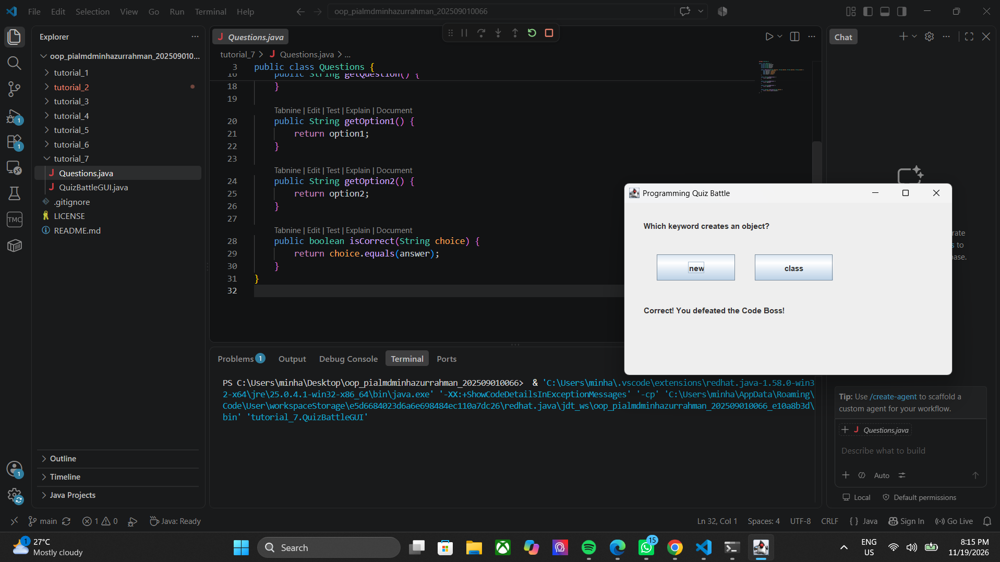

# oop_pialmdminhazurrahman_202509010066
# Object-Oriented Programming Fundamentals in Java

**Assignment 1 (Individual, 20%)** · DIT1113 / BIT1123 / BISE2093 Object Oriented Programming

| | |
|---|---|
| **Student Name** | PIAL MD MINHAZUR RAHMAN |
| **Student ID** | 202509010066 |
| **Class Code** | BIT1123 |
| **Program** | BIT |
| **Institution** | Faculty of Information Technology, City University Malaysia (Cyberjaya Campus) |
| **Lecturer** | Mr. Nazmirul Izzad Bin Nassir |

---

## Course Information

- **Course:** BIT1123 Object Oriented Programming (DIT1113 / BISE2093)
- **Assessment:** Assignment 1, Individual (20%)
- **Submission deadline:** 27 November 2026

### Brief Course Description

This course introduces the fundamentals of Object-Oriented Programming (OOP) using Java. It covers classes and objects, encapsulation, inheritance, abstraction and polymorphism, file handling, and building a simple graphical user interface. This repository consolidates all the practical tutorials completed during the semester, together with a self-reflective report.

---

## Repository Structure

```
oop_pialmdminhazurrahman_202509010066/
│
├── README.md
├── myreport.pdf          # Self-reflective report
│
├── tutorial_1/           # Hello World
│   └── tutorial_1.java
├── tutorial_2/           # Classes and objects
│   ├── Car.java
│   └── Main.java
├── tutorial_3/           # Encapsulation
│   ├── Student.java
│   ├── Main.java
│   └── documentation.txt
├── tutorial_4/           # Inheritance
│   ├── Employee.java
│   ├── Lecturer.java
│   └── Main.java
├── tutorial_5/           # Abstraction and polymorphism
│   ├── Appliances.java
│   └── Main.java
├── tutorial_6/           # File handling
│   ├── Main.java
│   └── task.txt
└── tutorial_7/           # Java Swing GUI
    ├── Questions.java
    ├── QuizBattleGUI.java
    └── final_output.png
```

---

## Tutorial Summary

| Tutorial | Topic | What was built | Key concepts |
|---|---|---|---|
| 1 | Getting started | A "Hello World!" program | `main` method, `System.out.println`, compiling and running |
| 2 | Classes and objects | A `Car` class with `brand`, `color` and `speed` and a `displayInfo()` method | Attributes, methods, object creation with `new` |
| 3 | Encapsulation | A `Student` class with private fields and getters/setters, plus `documentation.txt` answering why fields are private | `private`, getters and setters, data hiding |
| 4 | Inheritance | `Lecturer` extends `Employee` | `extends`, `super()`, `protected`, constructors, packages |
| 5 | Abstraction and polymorphism | Abstract `Appliance` class with `WashingMachine`, `Refrigerator`, `AirConditioner` and `Microwave` subclasses | `abstract`, `@Override`, polymorphism, arrays of parent type |
| 6 | File handling | A task manager that reads three tasks, saves them to `task.txt` and loads them back | `ArrayList`, `Scanner`, `BufferedWriter`/`BufferedReader`, try-with-resources, exception handling |
| 7 | GUI programming | "Programming Quiz Battle", a Swing quiz with a `Questions` model class | `JFrame`, `JLabel`, `JButton`, `ActionListener`, event handling |

---

## Technologies Used

- **Language:** Java (JDK [YOUR JDK VERSION])
- **IDE / Editor:** [YOUR IDE]
- **GUI toolkit:** Java Swing (`javax.swing`, `java.awt.event`)
- **Version control:** Git and GitHub

---

## How to Run the Projects

Make sure the JDK is installed (`javac -version`). Run all commands from the **repository root** unless stated otherwise.

### Tutorials 1 to 3 (default package)

These files have no `package` declaration, so compile and run them from inside their own folder.

```bash
# Tutorial 1
cd tutorial_1
javac tutorial_1.java
java tutorial_1

# Tutorial 2
cd ../tutorial_2
javac *.java
java Main

# Tutorial 3
cd ../tutorial_3
javac *.java
java Main
```

### Tutorials 4 to 7 (packaged)

These files declare `package tutorial_N;`, so compile and run them from the repository root.

```bash
# Tutorial 4
javac tutorial_4/*.java
java tutorial_4.Main

# Tutorial 5
javac tutorial_5/*.java
java tutorial_5.Main

# Tutorial 6 (asks for 3 tasks; task.txt is created in the folder you run from)
javac tutorial_6/*.java
java tutorial_6.Main

# Tutorial 7 (opens a GUI window)
javac tutorial_7/*.java
java tutorial_7.QuizBattleGUI
```

Alternatively, open the repository in an IDE such as IntelliJ IDEA, Eclipse, NetBeans or VS Code and run each `Main` class (or `QuizBattleGUI` for Tutorial 7) directly.

### Tutorial 7 output



---

## Reflection Summary

Across these seven tutorials I moved from printing a single line of text to designing small multi-class programs. The biggest shift was learning to think in terms of objects that own their data and behaviour, rather than one long sequence of instructions. Encapsulation (Tutorial 3) and abstraction with polymorphism (Tutorial 5) changed how I structure code the most. The main challenges were package structure and compiling from the correct folder, and understanding how an abstract parent class lets different child objects be handled through one type. I overcame them by experimenting, reading compiler errors carefully, and committing progress to Git after each tutorial. My next goals are input validation, interfaces and collections, and writing larger projects.

The full reflection is in [`myreport.pdf`](myreport.pdf).